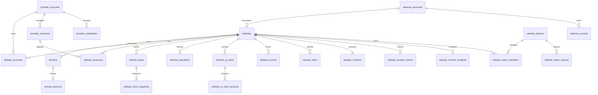

# 数据库结构（当前 v1.26.0）

24 张业务表；界面表格复用这些数据，不为每个视图新建数据库表。monitor_runner 独立记录巡检器状态。

网站数量仅为 page_count、calculator_count、article_count；computer_name 仅归网站。website_accounts 表达账号归属，website_resources 只关联真实资源，并按用途分别指定主要资源。默认凭据在账号内唯一。AdSense 账号收入使用 amount_usd、amount_cny；网站收入使用独立来源及币种，不跨币种换算。

## 完整字段字典

### `adsense_accounts`

| 字段 | 类型 | 必填 | 默认值 | 主键 |
|---|---|---|---|---|
| `id` | INTEGER | 否 | — | 1 |
| `name` | TEXT | 是 | — | — |
| `owner` | TEXT | 是 | — | — |
| `currency` | TEXT | 是 | 'USD' | — |
| `status` | TEXT | 是 | '未知' | — |
| `publisher_id` | TEXT | 否 | — | — |
| `opened_date` | TEXT | 否 | — | — |
| `memo` | TEXT | 否 | — | — |
| `created_at` | DATETIME | 否 | CURRENT_TIMESTAMP | — |

### `adsense_income`

| 字段 | 类型 | 必填 | 默认值 | 主键 |
|---|---|---|---|---|
| `id` | INTEGER | 否 | — | 1 |
| `adsense_account_id` | INTEGER | 是 | — | — |
| `income_month` | TEXT | 是 | — | — |
| `amount_usd` | REAL | 是 | 0 | — |
| `amount_cny` | REAL | 否 | — | — |
| `transfer_date` | TEXT | 否 | — | — |
| `memo` | TEXT | 否 | — | — |
| `created_at` | DATETIME | 否 | CURRENT_TIMESTAMP | — |

关联：`adsense_account_id` → `adsense_accounts.id`，删除规则 NO ACTION。

### `domain_favicons`

| 字段 | 类型 | 必填 | 默认值 | 主键 |
|---|---|---|---|---|
| `domain_id` | INTEGER | 否 | — | 1 |
| `source_domain` | TEXT | 是 | — | — |
| `source_url` | TEXT | 否 | — | — |
| `image_data` | TEXT | 否 | — | — |
| `mime_type` | TEXT | 否 | — | — |
| `content_hash` | TEXT | 否 | — | — |
| `status` | TEXT | 是 | 'pending' | — |
| `fetched_at` | TEXT | 否 | — | — |
| `last_attempt_at` | TEXT | 否 | — | — |
| `retry_after` | TEXT | 否 | — | — |
| `last_error` | TEXT | 否 | — | — |

关联：`domain_id` → `domains.id`，删除规则 CASCADE。

### `domains`

| 字段 | 类型 | 必填 | 默认值 | 主键 |
|---|---|---|---|---|
| `id` | INTEGER | 否 | — | 1 |
| `website_id` | INTEGER | 否 | — | — |
| `domain` | TEXT | 是 | — | — |
| `registrar` | TEXT | 是 | — | — |
| `registrar_link` | TEXT | 否 | — | — |
| `registrar_date` | TEXT | 是 | — | — |
| `expiry_date` | TEXT | 是 | — | — |
| `service_type` | TEXT | 是 | — | — |
| `domain_role` | TEXT | 是 | '主域名' | — |
| `is_primary` | INTEGER | 是 | 1 | — |
| `status` | TEXT | 是 | '离线' | — |
| `memo` | TEXT | 否 | — | — |
| `last_status_check_at` | DATETIME | 否 | — | — |
| `created_at` | DATETIME | 否 | CURRENT_TIMESTAMP | — |

关联：`website_id` → `websites.id`，删除规则 CASCADE。

### `monitor_runner`

| 字段 | 类型 | 必填 | 默认值 | 主键 |
|---|---|---|---|---|
| `id` | INTEGER | 否 | — | 1 |
| `last_started_at` | TEXT | 否 | — | — |
| `last_completed_at` | TEXT | 否 | — | — |
| `last_error` | TEXT | 否 | — | — |
| `lease_token` | TEXT | 否 | — | — |
| `lease_until` | TEXT | 否 | — | — |

### `provider_accounts`

| 字段 | 类型 | 必填 | 默认值 | 主键 |
|---|---|---|---|---|
| `id` | INTEGER | 否 | — | 1 |
| `provider` | TEXT | 是 | — | — |
| `name` | TEXT | 是 | — | — |
| `provider_name` | TEXT | 否 | — | — |
| `github_username` | TEXT | 否 | — | — |
| `login_email` | TEXT | 否 | — | — |
| `status` | TEXT | 是 | '正常' | — |
| `memo` | TEXT | 否 | — | — |
| `created_at` | DATETIME | 否 | CURRENT_TIMESTAMP | — |
| `updated_at` | DATETIME | 否 | CURRENT_TIMESTAMP | — |

### `provider_credentials`

| 字段 | 类型 | 必填 | 默认值 | 主键 |
|---|---|---|---|---|
| `id` | INTEGER | 否 | — | 1 |
| `account_id` | INTEGER | 是 | — | — |
| `label` | TEXT | 是 | — | — |
| `is_default` | INTEGER | 是 | 0 | — |
| `ciphertext` | TEXT | 是 | — | — |
| `token_last4` | TEXT | 否 | — | — |
| `expires_at` | TEXT | 否 | — | — |
| `status` | TEXT | 是 | '有效' | — |
| `created_at` | DATETIME | 否 | CURRENT_TIMESTAMP | — |
| `updated_at` | DATETIME | 否 | CURRENT_TIMESTAMP | — |

关联：`account_id` → `provider_accounts.id`，删除规则 CASCADE。

### `provider_resources`

| 字段 | 类型 | 必填 | 默认值 | 主键 |
|---|---|---|---|---|
| `id` | INTEGER | 否 | — | 1 |
| `account_id` | INTEGER | 否 | — | — |
| `provider` | TEXT | 是 | — | — |
| `name` | TEXT | 是 | — | — |
| `resource_url` | TEXT | 否 | — | — |
| `identifier` | TEXT | 否 | — | — |
| `ip_address` | TEXT | 否 | — | — |
| `port` | INTEGER | 否 | — | — |
| `region` | TEXT | 否 | — | — |
| `status` | TEXT | 是 | '正常' | — |
| `expires_at` | TEXT | 否 | — | — |
| `memo` | TEXT | 否 | — | — |
| `created_at` | DATETIME | 否 | CURRENT_TIMESTAMP | — |
| `updated_at` | DATETIME | 否 | CURRENT_TIMESTAMP | — |

关联：`account_id` → `provider_accounts.id`，删除规则 SET NULL。

### `website_accounts`

| 字段 | 类型 | 必填 | 默认值 | 主键 |
|---|---|---|---|---|
| `id` | INTEGER | 否 | — | 1 |
| `website_id` | INTEGER | 是 | — | — |
| `account_id` | INTEGER | 是 | — | — |
| `memo` | TEXT | 是 | '' | — |
| `created_at` | TEXT | 是 | CURRENT_TIMESTAMP | — |

关联：`account_id` → `provider_accounts.id`，删除规则 CASCADE。

关联：`website_id` → `websites.id`，删除规则 CASCADE。

### `website_ai_note_versions`

| 字段 | 类型 | 必填 | 默认值 | 主键 |
|---|---|---|---|---|
| `id` | INTEGER | 否 | — | 1 |
| `note_id` | INTEGER | 是 | — | — |
| `kind` | TEXT | 是 | — | — |
| `content` | TEXT | 是 | — | — |
| `version_no` | INTEGER | 是 | — | — |
| `created_at` | DATETIME | 否 | CURRENT_TIMESTAMP | — |

关联：`note_id` → `website_ai_notes.id`，删除规则 CASCADE。

### `website_ai_notes`

| 字段 | 类型 | 必填 | 默认值 | 主键 |
|---|---|---|---|---|
| `id` | INTEGER | 否 | — | 1 |
| `website_id` | INTEGER | 是 | — | — |
| `kind` | TEXT | 是 | — | — |
| `content` | TEXT | 是 | — | — |
| `created_at` | DATETIME | 否 | CURRENT_TIMESTAMP | — |
| `updated_at` | DATETIME | 否 | CURRENT_TIMESTAMP | — |
| `archived_at` | DATETIME | 否 | — | — |

关联：`website_id` → `websites.id`，删除规则 CASCADE。

### `website_batch_members`

| 字段 | 类型 | 必填 | 默认值 | 主键 |
|---|---|---|---|---|
| `id` | INTEGER | 否 | — | 1 |
| `batch_id` | INTEGER | 是 | — | — |
| `website_id` | INTEGER | 是 | — | — |
| `joined_at` | DATETIME | 是 | CURRENT_TIMESTAMP | — |
| `member_note` | TEXT | 否 | — | — |
| `membership_status` | TEXT | 是 | 'active' | — |
| `removed_at` | TEXT | 否 | — | — |
| `removed_reason` | TEXT | 否 | — | — |

关联：`website_id` → `websites.id`，删除规则 CASCADE。

关联：`batch_id` → `website_batches.id`，删除规则 CASCADE。

### `website_batch_reviews`

| 字段 | 类型 | 必填 | 默认值 | 主键 |
|---|---|---|---|---|
| `id` | INTEGER | 否 | — | 1 |
| `batch_id` | INTEGER | 是 | — | — |
| `reviewed_at` | DATETIME | 是 | CURRENT_TIMESTAMP | — |
| `member_count` | INTEGER | 是 | — | — |
| `stage_counts` | TEXT | 是 | '{}' | — |
| `content_totals` | TEXT | 是 | '{}' | — |
| `conclusion` | TEXT | 否 | — | — |
| `next_action` | TEXT | 否 | — | — |

关联：`batch_id` → `website_batches.id`，删除规则 CASCADE。

### `website_batches`

| 字段 | 类型 | 必填 | 默认值 | 主键 |
|---|---|---|---|---|
| `id` | INTEGER | 否 | — | 1 |
| `name` | TEXT | 是 | — | — |
| `source` | TEXT | 否 | — | — |
| `goal` | TEXT | 否 | — | — |
| `hypothesis` | TEXT | 否 | — | — |
| `status` | TEXT | 是 | '进行中' | — |
| `review_conclusion` | TEXT | 否 | — | — |
| `next_action` | TEXT | 否 | — | — |
| `review_requested_at` | TEXT | 否 | — | — |
| `reviewed_at` | TEXT | 否 | — | — |
| `archived_at` | TEXT | 否 | — | — |
| `created_at` | DATETIME | 否 | CURRENT_TIMESTAMP | — |
| `updated_at` | DATETIME | 否 | CURRENT_TIMESTAMP | — |

### `website_click_snapshots`

| 字段 | 类型 | 必填 | 默认值 | 主键 |
|---|---|---|---|---|
| `id` | INTEGER | 否 | — | 1 |
| `task_id` | INTEGER | 是 | — | — |
| `period_kind` | TEXT | 是 | — | — |
| `period_start` | TEXT | 是 | — | — |
| `period_end` | TEXT | 是 | — | — |
| `clicks` | INTEGER | 是 | — | — |
| `created_at` | DATETIME | 否 | CURRENT_TIMESTAMP | — |

关联：`task_id` → `website_tasks.id`，删除规则 CASCADE。

### `website_effort`

| 字段 | 类型 | 必填 | 默认值 | 主键 |
|---|---|---|---|---|
| `id` | INTEGER | 否 | — | 1 |
| `website_id` | INTEGER | 是 | — | — |
| `week_start` | TEXT | 是 | — | — |
| `hours` | REAL | 是 | — | — |
| `memo` | TEXT | 否 | — | — |
| `created_at` | DATETIME | 否 | CURRENT_TIMESTAMP | — |

关联：`website_id` → `websites.id`，删除规则 CASCADE。

### `website_income`

| 字段 | 类型 | 必填 | 默认值 | 主键 |
|---|---|---|---|---|
| `id` | INTEGER | 否 | — | 1 |
| `website_id` | INTEGER | 是 | — | — |
| `income_month` | TEXT | 是 | — | — |
| `source` | TEXT | 是 | — | — |
| `currency` | TEXT | 是 | — | — |
| `amount` | REAL | 是 | — | — |
| `memo` | TEXT | 否 | — | — |
| `created_at` | DATETIME | 否 | CURRENT_TIMESTAMP | — |

关联：`website_id` → `websites.id`，删除规则 CASCADE。

### `website_monitor_checks`

| 字段 | 类型 | 必填 | 默认值 | 主键 |
|---|---|---|---|---|
| `id` | INTEGER | 否 | — | 1 |
| `website_id` | INTEGER | 是 | — | — |
| `domain` | TEXT | 是 | — | — |
| `checked_at` | TEXT | 是 | — | — |
| `outcome` | TEXT | 是 | — | — |
| `reason` | TEXT | 是 | — | — |
| `http_status` | INTEGER | 否 | — | — |
| `response_ms` | INTEGER | 是 | — | — |
| `final_url` | TEXT | 是 | — | — |
| `title` | TEXT | 否 | — | — |

关联：`website_id` → `websites.id`，删除规则 CASCADE。

### `website_monitor_incidents`

| 字段 | 类型 | 必填 | 默认值 | 主键 |
|---|---|---|---|---|
| `id` | INTEGER | 否 | — | 1 |
| `website_id` | INTEGER | 是 | — | — |
| `domain` | TEXT | 是 | — | — |
| `reason` | TEXT | 是 | — | — |
| `opened_at` | TEXT | 是 | — | — |
| `last_seen_at` | TEXT | 是 | — | — |
| `resolved_at` | TEXT | 否 | — | — |
| `read_at` | TEXT | 否 | — | — |

关联：`website_id` → `websites.id`，删除规则 CASCADE。

### `website_monitors`

| 字段 | 类型 | 必填 | 默认值 | 主键 |
|---|---|---|---|---|
| `website_id` | INTEGER | 否 | — | 1 |
| `domain_id` | INTEGER | 否 | — | — |
| `domain` | TEXT | 否 | — | — |
| `enabled` | INTEGER | 是 | 1 | — |
| `allowed_redirect_hosts` | TEXT | 是 | '[]' | — |
| `status` | TEXT | 是 | 'unchecked' | — |
| `reason` | TEXT | 否 | — | — |
| `http_status` | INTEGER | 否 | — | — |
| `response_ms` | INTEGER | 否 | — | — |
| `final_url` | TEXT | 否 | — | — |
| `title` | TEXT | 否 | — | — |
| `checked_at` | TEXT | 否 | — | — |
| `next_check_at` | TEXT | 是 | '1970-01-01T00:00:00.000Z' | — |
| `consecutive_failures` | INTEGER | 是 | 0 | — |
| `config_version` | INTEGER | 是 | 0 | — |
| `lease_token` | TEXT | 否 | — | — |
| `lease_until` | TEXT | 否 | — | — |

关联：`website_id` → `websites.id`，删除规则 CASCADE。

### `website_operations`

| 字段 | 类型 | 必填 | 默认值 | 主键 |
|---|---|---|---|---|
| `id` | INTEGER | 否 | — | 1 |
| `website_id` | INTEGER | 是 | — | — |
| `operation_date` | TEXT | 是 | — | — |
| `operation_kind` | TEXT | 是 | — | — |
| `created_at` | DATETIME | 否 | CURRENT_TIMESTAMP | — |

关联：`website_id` → `websites.id`，删除规则 CASCADE。

### `website_resources`

| 字段 | 类型 | 必填 | 默认值 | 主键 |
|---|---|---|---|---|
| `id` | INTEGER | 否 | — | 1 |
| `website_id` | INTEGER | 是 | — | — |
| `resource_id` | INTEGER | 是 | — | — |
| `role` | TEXT | 是 | '其他' | — |
| `is_primary` | INTEGER | 是 | 0 | — |
| `memo` | TEXT | 否 | — | — |
| `created_at` | DATETIME | 否 | CURRENT_TIMESTAMP | — |

关联：`resource_id` → `provider_resources.id`，删除规则 RESTRICT。

关联：`website_id` → `websites.id`，删除规则 CASCADE。

### `website_tasks`

| 字段 | 类型 | 必填 | 默认值 | 主键 |
|---|---|---|---|---|
| `id` | INTEGER | 否 | — | 1 |
| `website_id` | INTEGER | 是 | — | — |
| `task_type` | TEXT | 是 | '其他' | — |
| `title` | TEXT | 是 | — | — |
| `description` | TEXT | 否 | — | — |
| `status` | TEXT | 是 | '待做' | — |
| `completion_summary` | TEXT | 否 | — | — |
| `result_url` | TEXT | 否 | — | — |
| `due_at` | TEXT | 否 | — | — |
| `completed_at` | TEXT | 否 | — | — |
| `review_of_task_id` | INTEGER | 否 | — | — |
| `review_delay_days` | INTEGER | 是 | 28 | — |
| `review_window_days` | INTEGER | 是 | 28 | — |
| `review_conclusion` | TEXT | 否 | — | — |
| `review_basis` | TEXT | 否 | — | — |
| `baseline_missing` | INTEGER | 是 | 0 | — |
| `created_at` | DATETIME | 否 | CURRENT_TIMESTAMP | — |
| `updated_at` | DATETIME | 否 | CURRENT_TIMESTAMP | — |

关联：`review_of_task_id` → `website_tasks.id`，删除规则 CASCADE。

关联：`website_id` → `websites.id`，删除规则 CASCADE。

### `websites`

| 字段 | 类型 | 必填 | 默认值 | 主键 |
|---|---|---|---|---|
| `id` | INTEGER | 否 | — | 1 |
| `name` | TEXT | 是 | — | — |
| `stage` | TEXT | 是 | '待评估' | — |
| `lifecycle` | TEXT | 是 | 'active' | — |
| `ownership` | TEXT | 是 | '自营网站' | — |
| `industry` | TEXT | 否 | — | — |
| `platform` | TEXT | 是 | '其他' | — |
| `platform_other` | TEXT | 否 | — | — |
| `adsense_account_id` | INTEGER | 否 | — | — |
| `adsense_connected` | TEXT | 是 | '未知' | — |
| `adsense_opened_date` | TEXT | 否 | — | — |
| `gsc_connected` | TEXT | 是 | '未知' | — |
| `seo_last_date` | TEXT | 否 | — | — |
| `daily_clicks` | INTEGER | 否 | — | — |
| `daily_clicks_range` | TEXT | 否 | — | — |
| `clicks_updated_date` | TEXT | 否 | — | — |
| `calculator_count` | INTEGER | 否 | — | — |
| `article_count` | INTEGER | 否 | — | — |
| `computer_name` | TEXT | 否 | — | — |
| `content_stats_updated_date` | TEXT | 否 | — | — |
| `potential` | TEXT | 否 | — | — |
| `priority_order` | INTEGER | 是 | 0 | — |
| `next_action` | TEXT | 否 | — | — |
| `next_action_due_date` | TEXT | 否 | — | — |
| `next_action_status` | TEXT | 是 | '待做' | — |
| `new_site_override` | INTEGER | 否 | — | — |
| `page_count` | INTEGER | 否 | — | — |
| `created_at` | DATETIME | 否 | CURRENT_TIMESTAMP | — |

关联：`adsense_account_id` → `adsense_accounts.id`，删除规则 NO ACTION。

## 升级和备份

v1.24 → v1.25 → v1.26 顺序升级。旧值、旧监控历史、占位资源和原始关联先归档，完整数据库备份作为恢复依据；当前运行没有长期转换器。历史 SQL、旧库测试夹具和 ADR 与运行数据格式隔离。

普通 JSON 使用 format_version=1，仅 /api/backups 读写，明确字段白名单。凭据、图标缓存及运行心跳不进入普通备份。详细发布和回滚步骤见 cleanup-release.md。
