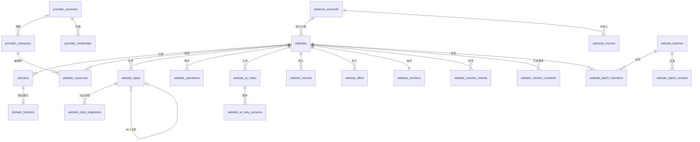

# 数据库结构与数据字典

更新：2026-11-21。由当前 `schema.sql` 核对，数据库使用现有 Cloudflare D1 / SQLite。生产库同日已完成 v1.24.0 迁移，网站、域名及历史关系保留，外键和新约束检查通过。

## 核心关系

`monitor_runner` 为监控运行器的独立单行记录。

## 数据归属与约束

- 网站是数量、点击、电脑、任务、收入、投入的主体。域名至多关联一个网站；网站保留至少一个域名，主域名至多一个。
- `website_resources` 的唯一关系为网站、资源、用途；每网站每用途最多一个主要资源。旧冲突用途保留待人工核对。
- `provider_accounts.provider` 是分类，`provider_name` 是实际服务商品牌，`github_username` 是 GitHub 登录账号标识，`login_email` 是账号邮箱。
- `provider_credentials` 加密保存 Token，每账号最多一个默认凭据。密钥在部署环境独立保存，不写入备份。
- `calculator_count` / `article_count` 为通用字段，`wp_` 字段为旧别名；触发器保证存储一致，写接口拒绝相互矛盾的值。
- `operating_scenario` / `scenario_note`、域名 `computer_name` 和旧监控内容规则只为历史兼容保留。
- 新复盘 `scenario_counts` 为 `{}`，内容总计用通用数量；历史快照不改写。
- 图标在 `domain_favicons.image_data` 中以 Base64 TEXT 保存，来源字节限制 256 KiB；未放入普通 JSON / Excel 导出。

## 表与字段

下表列出初始化模型全部 23 张业务表的真实字段、类型、默认值和外键。生产库额外保留的历史表 `alertcfg` 单列于文末。`PK` 为主键；无默认值用 `—`；业务必填规则还由接口验证。
### `adsense_accounts`

| 字段 | 类型 | 数据库约束 | 默认值 |
|---|---|---|---|
| `id` | INTEGER | PK | — |
| `name` | TEXT | NOT NULL | — |
| `owner` | TEXT | NOT NULL | — |
| `currency` | TEXT | NOT NULL | `'USD'` |
| `status` | TEXT | NOT NULL | `'未知'` |
| `publisher_id` | TEXT |  | — |
| `opened_date` | TEXT |  | — |
| `memo` | TEXT |  | — |
| `created_at` | DATETIME |  | `CURRENT_TIMESTAMP` |

索引：`uq_adsense_accounts_publisher_id`（唯一）、`sqlite_autoindex_adsense_accounts_1`（唯一）。

### `adsense_income`

| 字段 | 类型 | 数据库约束 | 默认值 |
|---|---|---|---|
| `id` | INTEGER | PK | — |
| `adsense_account_id` | INTEGER | NOT NULL | — |
| `income_month` | TEXT | NOT NULL | — |
| `amount` | REAL | NOT NULL | `0` |
| `amount_usd` | REAL | NOT NULL | `0` |
| `amount_cny` | REAL |  | — |
| `transfer_date` | TEXT |  | — |
| `memo` | TEXT |  | — |
| `created_at` | DATETIME |  | `CURRENT_TIMESTAMP` |

外键：`adsense_account_id` → `adsense_accounts.id`（删除：NO ACTION）。

索引：`sqlite_autoindex_adsense_income_1`（唯一）。

### `domain_favicons`

| 字段 | 类型 | 数据库约束 | 默认值 |
|---|---|---|---|
| `domain_id` | INTEGER | PK | — |
| `source_domain` | TEXT | NOT NULL | — |
| `source_url` | TEXT |  | — |
| `image_data` | TEXT |  | — |
| `mime_type` | TEXT |  | — |
| `content_hash` | TEXT |  | — |
| `status` | TEXT | NOT NULL | `'pending'` |
| `fetched_at` | TEXT |  | — |
| `last_attempt_at` | TEXT |  | — |
| `retry_after` | TEXT |  | — |
| `last_error` | TEXT |  | — |

外键：`domain_id` → `domains.id`（删除：CASCADE）。

### `domains`

| 字段 | 类型 | 数据库约束 | 默认值 |
|---|---|---|---|
| `id` | INTEGER | PK | — |
| `website_id` | INTEGER |  | — |
| `domain` | TEXT | NOT NULL | — |
| `registrar` | TEXT | NOT NULL | — |
| `registrar_link` | TEXT |  | — |
| `registrar_date` | TEXT | NOT NULL | — |
| `expiry_date` | TEXT | NOT NULL | — |
| `service_type` | TEXT | NOT NULL | — |
| `domain_role` | TEXT | NOT NULL | `'主域名'` |
| `is_primary` | INTEGER | NOT NULL | `1` |
| `status` | TEXT | NOT NULL | `'离线'` |
| `memo` | TEXT |  | — |
| `last_status_check_at` | DATETIME |  | — |
| `computer_name` | TEXT |  | — |
| `created_at` | DATETIME |  | `CURRENT_TIMESTAMP` |

外键：`website_id` → `websites.id`（删除：CASCADE）。

索引：`idx_domains_one_primary_per_website`（唯一）、`idx_domains_expiry_date`、`idx_domains_website`、`uq_domains_normalized_name`（唯一）。

### `monitor_runner`

| 字段 | 类型 | 数据库约束 | 默认值 |
|---|---|---|---|
| `id` | INTEGER | PK | — |
| `last_started_at` | TEXT |  | — |
| `last_completed_at` | TEXT |  | — |
| `last_error` | TEXT |  | — |
| `lease_token` | TEXT |  | — |
| `lease_until` | TEXT |  | — |

### `provider_accounts`

| 字段 | 类型 | 数据库约束 | 默认值 |
|---|---|---|---|
| `id` | INTEGER | PK | — |
| `provider` | TEXT | NOT NULL | — |
| `name` | TEXT | NOT NULL | — |
| `provider_name` | TEXT |  | — |
| `github_username` | TEXT |  | — |
| `login_email` | TEXT |  | — |
| `status` | TEXT | NOT NULL | `'正常'` |
| `memo` | TEXT |  | — |
| `created_at` | DATETIME |  | `CURRENT_TIMESTAMP` |
| `updated_at` | DATETIME |  | `CURRENT_TIMESTAMP` |

索引：`sqlite_autoindex_provider_accounts_1`（唯一）。

### `provider_credentials`

| 字段 | 类型 | 数据库约束 | 默认值 |
|---|---|---|---|
| `id` | INTEGER | PK | — |
| `account_id` | INTEGER | NOT NULL | — |
| `label` | TEXT | NOT NULL | — |
| `is_default` | INTEGER | NOT NULL | `0` |
| `ciphertext` | TEXT | NOT NULL | — |
| `token_last4` | TEXT |  | — |
| `expires_at` | TEXT |  | — |
| `status` | TEXT | NOT NULL | `'有效'` |
| `created_at` | DATETIME |  | `CURRENT_TIMESTAMP` |
| `updated_at` | DATETIME |  | `CURRENT_TIMESTAMP` |

外键：`account_id` → `provider_accounts.id`（删除：CASCADE）。

索引：`idx_credentials_account`、`idx_credentials_default`（唯一）。

### `provider_resources`

| 字段 | 类型 | 数据库约束 | 默认值 |
|---|---|---|---|
| `id` | INTEGER | PK | — |
| `account_id` | INTEGER |  | — |
| `provider` | TEXT | NOT NULL | — |
| `name` | TEXT | NOT NULL | — |
| `resource_url` | TEXT |  | — |
| `identifier` | TEXT |  | — |
| `ip_address` | TEXT |  | — |
| `port` | INTEGER |  | — |
| `region` | TEXT |  | — |
| `status` | TEXT | NOT NULL | `'正常'` |
| `expires_at` | TEXT |  | — |
| `memo` | TEXT |  | — |
| `created_at` | DATETIME |  | `CURRENT_TIMESTAMP` |
| `updated_at` | DATETIME |  | `CURRENT_TIMESTAMP` |

外键：`account_id` → `provider_accounts.id`（删除：SET NULL）。

索引：`idx_provider_resources_account_ownership`（唯一）、`idx_provider_resources_provider`、`sqlite_autoindex_provider_resources_1`（唯一）。

### `website_ai_note_versions`

| 字段 | 类型 | 数据库约束 | 默认值 |
|---|---|---|---|
| `id` | INTEGER | PK | — |
| `note_id` | INTEGER | NOT NULL | — |
| `kind` | TEXT | NOT NULL | — |
| `content` | TEXT | NOT NULL | — |
| `version_no` | INTEGER | NOT NULL | — |
| `created_at` | DATETIME |  | `CURRENT_TIMESTAMP` |

外键：`note_id` → `website_ai_notes.id`（删除：CASCADE）。

索引：`idx_website_ai_note_versions_note`。

### `website_ai_notes`

| 字段 | 类型 | 数据库约束 | 默认值 |
|---|---|---|---|
| `id` | INTEGER | PK | — |
| `website_id` | INTEGER | NOT NULL | — |
| `kind` | TEXT | NOT NULL | — |
| `content` | TEXT | NOT NULL | — |
| `created_at` | DATETIME |  | `CURRENT_TIMESTAMP` |
| `updated_at` | DATETIME |  | `CURRENT_TIMESTAMP` |
| `archived_at` | DATETIME |  | — |

外键：`website_id` → `websites.id`（删除：CASCADE）。

索引：`idx_website_ai_notes_site`。

### `website_batch_members`

| 字段 | 类型 | 数据库约束 | 默认值 |
|---|---|---|---|
| `id` | INTEGER | PK | — |
| `batch_id` | INTEGER | NOT NULL | — |
| `website_id` | INTEGER | NOT NULL | — |
| `joined_at` | DATETIME | NOT NULL | `CURRENT_TIMESTAMP` |
| `member_note` | TEXT |  | — |
| `membership_status` | TEXT | NOT NULL | `'active'` |
| `removed_at` | TEXT |  | — |
| `removed_reason` | TEXT |  | — |

外键：`website_id` → `websites.id`（删除：CASCADE）；`batch_id` → `website_batches.id`（删除：CASCADE）。

索引：`idx_website_batch_members_website`、`idx_website_batch_members_batch`、`sqlite_autoindex_website_batch_members_1`（唯一）。

### `website_batch_reviews`

| 字段 | 类型 | 数据库约束 | 默认值 |
|---|---|---|---|
| `id` | INTEGER | PK | — |
| `batch_id` | INTEGER | NOT NULL | — |
| `reviewed_at` | DATETIME | NOT NULL | `CURRENT_TIMESTAMP` |
| `member_count` | INTEGER | NOT NULL | — |
| `scenario_counts` | TEXT | NOT NULL | `'{}'` |
| `stage_counts` | TEXT | NOT NULL | `'{}'` |
| `content_totals` | TEXT | NOT NULL | `'{}'` |
| `conclusion` | TEXT |  | — |
| `next_action` | TEXT |  | — |

外键：`batch_id` → `website_batches.id`（删除：CASCADE）。

索引：`idx_website_batch_reviews_batch`。

### `website_batches`

| 字段 | 类型 | 数据库约束 | 默认值 |
|---|---|---|---|
| `id` | INTEGER | PK | — |
| `name` | TEXT | NOT NULL | — |
| `source` | TEXT |  | — |
| `goal` | TEXT |  | — |
| `hypothesis` | TEXT |  | — |
| `status` | TEXT | NOT NULL | `'进行中'` |
| `review_conclusion` | TEXT |  | — |
| `next_action` | TEXT |  | — |
| `review_requested_at` | TEXT |  | — |
| `reviewed_at` | TEXT |  | — |
| `archived_at` | TEXT |  | — |
| `created_at` | DATETIME |  | `CURRENT_TIMESTAMP` |
| `updated_at` | DATETIME |  | `CURRENT_TIMESTAMP` |

索引：`idx_website_batches_status`。

### `website_click_snapshots`

| 字段 | 类型 | 数据库约束 | 默认值 |
|---|---|---|---|
| `id` | INTEGER | PK | — |
| `task_id` | INTEGER | NOT NULL | — |
| `period_kind` | TEXT | NOT NULL | — |
| `period_start` | TEXT | NOT NULL | — |
| `period_end` | TEXT | NOT NULL | — |
| `clicks` | INTEGER | NOT NULL | — |
| `created_at` | DATETIME |  | `CURRENT_TIMESTAMP` |

外键：`task_id` → `website_tasks.id`（删除：CASCADE）。

索引：`sqlite_autoindex_website_click_snapshots_1`（唯一）。

### `website_effort`

| 字段 | 类型 | 数据库约束 | 默认值 |
|---|---|---|---|
| `id` | INTEGER | PK | — |
| `website_id` | INTEGER | NOT NULL | — |
| `week_start` | TEXT | NOT NULL | — |
| `hours` | REAL | NOT NULL | — |
| `memo` | TEXT |  | — |
| `created_at` | DATETIME |  | `CURRENT_TIMESTAMP` |

外键：`website_id` → `websites.id`（删除：CASCADE）。

索引：`sqlite_autoindex_website_effort_1`（唯一）。

### `website_income`

| 字段 | 类型 | 数据库约束 | 默认值 |
|---|---|---|---|
| `id` | INTEGER | PK | — |
| `website_id` | INTEGER | NOT NULL | — |
| `income_month` | TEXT | NOT NULL | — |
| `source` | TEXT | NOT NULL | — |
| `currency` | TEXT | NOT NULL | — |
| `amount` | REAL | NOT NULL | — |
| `memo` | TEXT |  | — |
| `created_at` | DATETIME |  | `CURRENT_TIMESTAMP` |

外键：`website_id` → `websites.id`（删除：CASCADE）。

索引：`idx_website_income_month`、`sqlite_autoindex_website_income_1`（唯一）。

### `website_monitor_checks`

| 字段 | 类型 | 数据库约束 | 默认值 |
|---|---|---|---|
| `id` | INTEGER | PK | — |
| `website_id` | INTEGER | NOT NULL | — |
| `domain` | TEXT | NOT NULL | — |
| `checked_at` | TEXT | NOT NULL | — |
| `outcome` | TEXT | NOT NULL | — |
| `reason` | TEXT | NOT NULL | — |
| `http_status` | INTEGER |  | — |
| `response_ms` | INTEGER | NOT NULL | — |
| `final_url` | TEXT | NOT NULL | — |
| `title` | TEXT |  | — |
| `content_complete` | INTEGER | NOT NULL | — |

外键：`website_id` → `websites.id`（删除：CASCADE）。

索引：`idx_monitor_checks_retention`、`idx_monitor_checks_site`。

### `website_monitor_incidents`

| 字段 | 类型 | 数据库约束 | 默认值 |
|---|---|---|---|
| `id` | INTEGER | PK | — |
| `website_id` | INTEGER | NOT NULL | — |
| `domain` | TEXT | NOT NULL | — |
| `reason` | TEXT | NOT NULL | — |
| `opened_at` | TEXT | NOT NULL | — |
| `last_seen_at` | TEXT | NOT NULL | — |
| `resolved_at` | TEXT |  | — |
| `read_at` | TEXT |  | — |

外键：`website_id` → `websites.id`（删除：CASCADE）。

索引：`idx_monitor_unread_incidents`、`idx_monitor_open_incident`（唯一）。

### `website_monitors`

| 字段 | 类型 | 数据库约束 | 默认值 |
|---|---|---|---|
| `website_id` | INTEGER | PK | — |
| `domain_id` | INTEGER |  | — |
| `domain` | TEXT |  | — |
| `enabled` | INTEGER | NOT NULL | `1` |
| `required_text` | TEXT | NOT NULL | `'[]'` |
| `forbidden_text` | TEXT | NOT NULL | `'[]'` |
| `allowed_redirect_hosts` | TEXT | NOT NULL | `'[]'` |
| `baseline_title` | TEXT |  | — |
| `status` | TEXT | NOT NULL | `'unchecked'` |
| `reason` | TEXT |  | — |
| `http_status` | INTEGER |  | — |
| `response_ms` | INTEGER |  | — |
| `final_url` | TEXT |  | — |
| `title` | TEXT |  | — |
| `checked_at` | TEXT |  | — |
| `next_check_at` | TEXT | NOT NULL | `'1970-01-01T00:00:00.000Z'` |
| `consecutive_failures` | INTEGER | NOT NULL | `0` |
| `config_version` | INTEGER | NOT NULL | `0` |
| `lease_token` | TEXT |  | — |
| `lease_until` | TEXT |  | — |

外键：`website_id` → `websites.id`（删除：CASCADE）。

索引：`idx_monitor_due`。

### `website_operations`

| 字段 | 类型 | 数据库约束 | 默认值 |
|---|---|---|---|
| `id` | INTEGER | PK | — |
| `website_id` | INTEGER | NOT NULL | — |
| `operation_date` | TEXT | NOT NULL | — |
| `operation_kind` | TEXT | NOT NULL | — |
| `created_at` | DATETIME |  | `CURRENT_TIMESTAMP` |

外键：`website_id` → `websites.id`（删除：CASCADE）。

索引：`idx_website_operations_date`、`sqlite_autoindex_website_operations_1`（唯一）。

### `website_resources`

| 字段 | 类型 | 数据库约束 | 默认值 |
|---|---|---|---|
| `id` | INTEGER | PK | — |
| `website_id` | INTEGER | NOT NULL | — |
| `resource_id` | INTEGER | NOT NULL | — |
| `role` | TEXT | NOT NULL | `'其他'` |
| `is_primary` | INTEGER | NOT NULL | `0` |
| `memo` | TEXT |  | — |
| `created_at` | DATETIME |  | `CURRENT_TIMESTAMP` |

外键：`resource_id` → `provider_resources.id`（删除：RESTRICT）；`website_id` → `websites.id`（删除：CASCADE）。

索引：`idx_website_resources_resource`、`idx_website_resources_one_primary`（唯一）、`sqlite_autoindex_website_resources_1`（唯一）。

### `website_tasks`

| 字段 | 类型 | 数据库约束 | 默认值 |
|---|---|---|---|
| `id` | INTEGER | PK | — |
| `website_id` | INTEGER | NOT NULL | — |
| `task_type` | TEXT | NOT NULL | `'其他'` |
| `title` | TEXT | NOT NULL | — |
| `description` | TEXT |  | — |
| `status` | TEXT | NOT NULL | `'待做'` |
| `completion_summary` | TEXT |  | — |
| `result_url` | TEXT |  | — |
| `due_at` | TEXT |  | — |
| `completed_at` | TEXT |  | — |
| `review_of_task_id` | INTEGER |  | — |
| `review_delay_days` | INTEGER | NOT NULL | `28` |
| `review_window_days` | INTEGER | NOT NULL | `28` |
| `review_conclusion` | TEXT |  | — |
| `review_basis` | TEXT |  | — |
| `baseline_missing` | INTEGER | NOT NULL | `0` |
| `created_at` | DATETIME |  | `CURRENT_TIMESTAMP` |
| `updated_at` | DATETIME |  | `CURRENT_TIMESTAMP` |

外键：`review_of_task_id` → `website_tasks.id`（删除：CASCADE）；`website_id` → `websites.id`（删除：CASCADE）。

索引：`idx_website_tasks_type`、`idx_website_tasks_queue`、`sqlite_autoindex_website_tasks_1`（唯一）。

### `websites`

| 字段 | 类型 | 数据库约束 | 默认值 |
|---|---|---|---|
| `id` | INTEGER | PK | — |
| `name` | TEXT | NOT NULL | — |
| `stage` | TEXT | NOT NULL | `'待评估'` |
| `lifecycle` | TEXT | NOT NULL | `'active'` |
| `ownership` | TEXT | NOT NULL | `'自营网站'` |
| `industry` | TEXT |  | — |
| `platform` | TEXT | NOT NULL | `'其他'` |
| `platform_other` | TEXT |  | — |
| `adsense_account_id` | INTEGER |  | — |
| `adsense_connected` | TEXT | NOT NULL | `'未知'` |
| `adsense_opened_date` | TEXT |  | — |
| `gsc_connected` | TEXT | NOT NULL | `'未知'` |
| `seo_last_date` | TEXT |  | — |
| `daily_clicks` | INTEGER |  | — |
| `daily_clicks_range` | TEXT |  | — |
| `clicks_updated_date` | TEXT |  | — |
| `calculator_count` | INTEGER |  | — |
| `article_count` | INTEGER |  | — |
| `computer_name` | TEXT |  | — |
| `wp_calculator_count` | INTEGER |  | — |
| `wp_article_count` | INTEGER |  | — |
| `content_stats_updated_date` | TEXT |  | — |
| `potential` | TEXT |  | — |
| `priority_order` | INTEGER | NOT NULL | `0` |
| `next_action` | TEXT |  | — |
| `next_action_due_date` | TEXT |  | — |
| `next_action_status` | TEXT | NOT NULL | `'待做'` |
| `new_site_override` | INTEGER |  | — |
| `operating_scenario` | TEXT |  | — |
| `scenario_note` | TEXT |  | — |
| `page_count` | INTEGER |  | — |
| `created_at` | DATETIME |  | `CURRENT_TIMESTAMP` |

外键：`adsense_account_id` → `adsense_accounts.id`（删除：NO ACTION）。

索引：`idx_websites_platform`、`idx_websites_ownership`、`idx_websites_stage_priority`。

## 接口变化

| 接口 | 变化 |
|---|---|
| `GET /api/websites` | 返回通用数量、网站电脑、分别选定的 `hosting` / `repository` |
| 网站创建、更新、AI 回写、备份导入 | 支持通用数量及旧数量别名；同请求冲突返回 400 |
| `POST /api/resources/links` | 旧部署类用途映射到托管，主要标记仅清理同用途 |
| 账号创建 / 编辑 | 支持 `provider_name`、`github_username` |
| 凭据创建 / 编辑 | 支持布尔值 `is_default`，列表仅返回掩码 |
| `POST /api/websites/:id/copy` | 登录后按主要仓库读取账号邮箱及默认 Token，返回固定格式 `text`；禁止缓存 |
| `GET /api/domains/:id/favicon` | 登录后只读缓存图片，缺失返回 404 |
| `POST /api/domains/:id/favicon` | 登录后显式刷新；失败保留已有图片 |

## 升级与恢复

1. 核对当前库版本并保存完整数据库备份，独立保存凭据加密密钥。
2. 从 v1.23 升级时执行 v1.24 迁移一次；不重复执行，不用初始化 schema 覆盖旧库。
3. 核对网站、域名、资源关联、凭据和历史表数量；执行外键完整性检查。
4. 部署 Pages 和监控 Worker，两者共用迁移后的数据库。
5. 检查主资源、品牌名称、默认 Token、图标及复制功能。旧冲突关联在网站部署详情中核对。

普通 JSON / Excel 用于业务数据恢复，不包含凭据和图标缓存。完整数据库恢复需要同一加密密钥才能解密原凭据。出现异常时使用迁移前备份恢复，并配套恢复旧应用版本；不通过删除新列模拟回滚。

## 生产库保留的历史表 `alertcfg`

2026-11-21 核对时该表为 0 行，不属于当前业务模型。本次迁移保留该表；新数据库初始化不创建它。生产库因此有 23 张当前业务表及 1 张历史表，Cloudflare / SQLite 内部表不计入。

| 字段 | 类型 | 数据库约束 | 默认值 |
|---|---|---|---|
| `id` | INTEGER | PK | — |
| `tg_token` | TEXT | NOT NULL | — |
| `tg_userid` | TEXT | NOT NULL | — |
| `days` | INTEGER | NOT NULL | `30` |
| `created_at` | DATETIME |  | `CURRENT_TIMESTAMP` |
